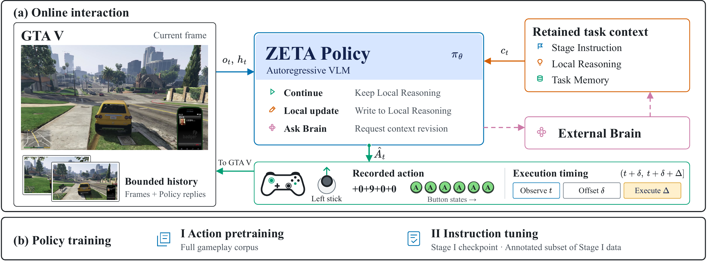
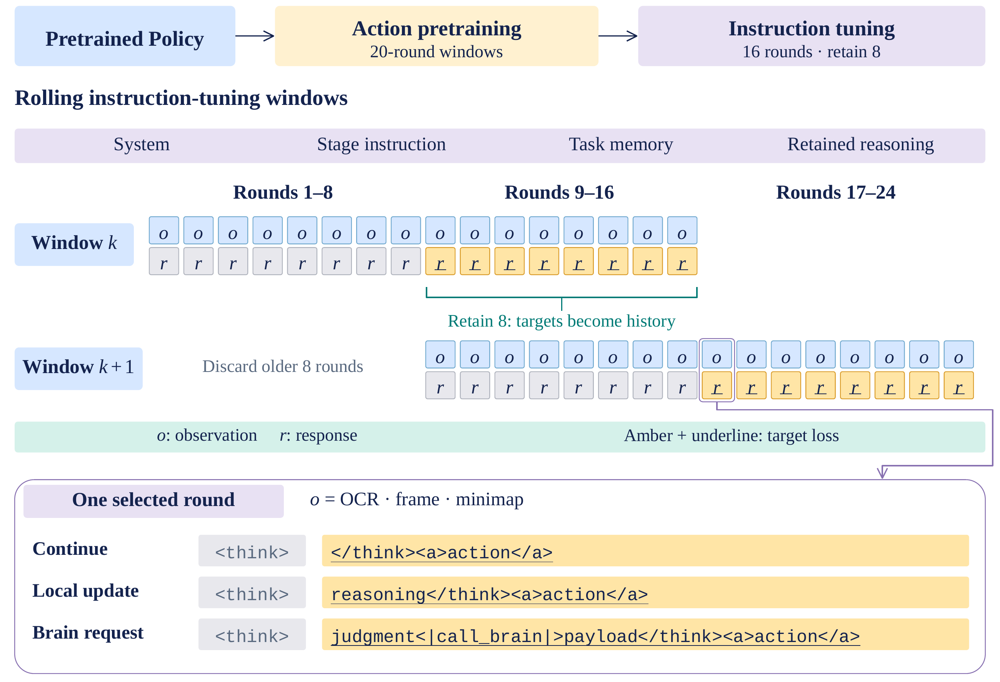
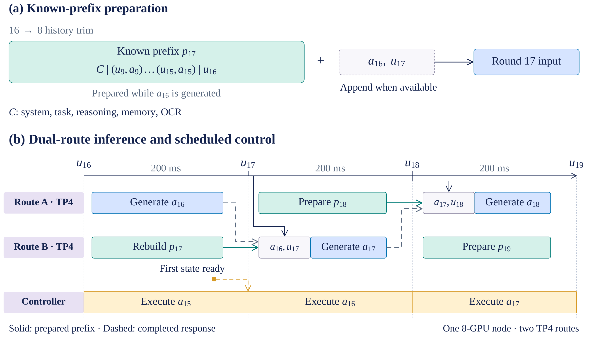

<div align="center">

<h1> ZETA</h1>

### Towards Real-time AGI in the Frontier AAA Game with Zeroth Embodied Task Agent

A real-time game agent powered by **MOSS-ZETA-preview**, combining visual control, adaptive reasoning and persistent memory in GTA V.

[中文](README.zh-CN.md) · [Project page](https://openmoss.ai/MOSS-ZETA/) · [Method](#method) · [Get started](#get-started) · [Inference infrastructure](infra/)

</div>

https://github.com/user-attachments/assets/0864f57e-090a-4959-9087-6caf0f3a7cd0

## What is ZETA?

Open-world play combines fast control with goals that persist for minutes. Driving, combat, flight and on-foot interaction also give the same controller buttons different meanings. ZETA connects a responsive visual **Policy** with an external **Brain** that maintains the task context across these changes. “Zeroth” describes the stage before taking the first action in the physical world.

- **React to the screen:** the Policy reads the full frame, minimap, available OCR and recent interaction history, then generates short gamepad actions.
- **Think when needed:** the same response decides whether to continue the current plan, revise a local judgment or ask Brain to review the stage.
- **Remember beyond the visual window:** stage instructions, task memory and local reasoning keep control connected to the longer goal.
- **Keep inference and execution moving:** dual TP4 routes prepare context and generate actions alongside a shared 200ms execution schedule.

## Video demos

Driving, pursuit, combat and water traversal, with a dynamic controller overlay. The [project page](https://openmoss.ai/MOSS-ZETA/#demos) provides larger players and category filters.

<table>
  <tr>
    <td width="50%" align="center">
      <strong>Escape the police</strong><br>
      <video src="https://github.com/user-attachments/assets/f2798157-b890-4bb3-83b1-f4632e289fa9" controls width="100%" aria-label="Escape the police"></video><br>
      70s
    </td>
    <td width="50%" align="center">
      <strong>Track and snipe a target</strong><br>
      <video src="https://github.com/user-attachments/assets/43200feb-8689-4206-8d27-5687e2e7b44f" controls width="100%" aria-label="Track and snipe a target"></video><br>
      10s
    </td>
  </tr>
  <tr>
    <td width="50%" align="center">
      <strong>Fire from a helicopter</strong><br>
      <video src="https://github.com/user-attachments/assets/48a00ad3-b160-4ceb-8357-f1ed4418b3f3" controls width="100%" aria-label="Fire from a helicopter"></video><br>
      31s
    </td>
    <td width="50%" align="center">
      <strong>Chase a plane across the hills</strong><br>
      <video src="https://github.com/user-attachments/assets/cd3a5a2c-893f-4834-b581-adef0e7f510b" controls width="100%" aria-label="Chase a plane across the hills"></video><br>
      37s
    </td>
  </tr>
  <tr>
    <td width="50%" align="center">
      <strong>Ride through a four-star pursuit</strong><br>
      <video src="https://github.com/user-attachments/assets/ff8b13f6-d3a4-4d8b-a434-e390a333dc6e" controls width="100%" aria-label="Ride through a four-star pursuit"></video><br>
      36s
    </td>
    <td width="50%" align="center">
      <strong>Dive from the pier</strong><br>
      <video src="https://github.com/user-attachments/assets/7db11e90-2e5f-440b-b09d-882d9d254003" controls width="100%" aria-label="Dive from the pier"></video><br>
      30s
    </td>
  </tr>
  <tr>
    <td width="50%" align="center">
      <strong>Vault a fence in pursuit</strong><br>
      <video src="https://github.com/user-attachments/assets/72079c68-e439-4722-adab-de65f0f54232" controls width="100%" aria-label="Vault a fence in pursuit"></video><br>
      10s
    </td>
    <td width="50%" align="center">
      <strong>Pull down a hillside structure</strong><br>
      <video src="https://github.com/user-attachments/assets/37b7a4ad-15a1-4db9-bd00-8bcca8aeb6ce" controls width="100%" aria-label="Pull down a hillside structure"></video><br>
      13s
    </td>
  </tr>
</table>

## Method

### Fast control and deliberate task updates

**System 1 — Policy** handles immediate visual control. **System 2 — Brain** reviews accumulated evidence and updates the persistent task state. They communicate through three fields: the current **stage instruction**, **task memory** and **local reasoning**.



| Policy decision | What changes | How control continues |
| --- | --- | --- |
| Continue | Retain the current judgment and task context | Generate the next action |
| Local update | Policy supplies a new judgment; Brain refreshes memory under the same stage instruction | Prepare the updated context alongside control |
| Stage review | Brain reviews the instruction, memory and local reasoning | Confirm pause, commit the reviewed state and resume |

A periodic memory refresh covers long stretches without an accepted update. In the optional standby configuration, a new context becomes active only when the standby service is ready to take over. This keeps an unfinished update from changing the active Policy session.

### Two-stage Policy training

The Policy is initialized from **Qwen3.5-9B**. Both stages train the same autoregressive model to produce controller actions; the second stage also teaches task-conditioned reasoning and update decisions.

| Stage | Training data | What it learns |
| --- | --- | --- |
| Action pretraining | Approximately 4,000 hours of human GTA V gameplay, split roughly equally between free play and task-directed play | Visual control and context-dependent gamepad behavior |
| Instruction tuning | Approximately 1,200 hours selected from that corpus, annotated with instructions, memory, reasoning and update decisions | Connect immediate actions to task progress and decide when to update context |



Action pretraining uses 20-round windows. Instruction tuning uses up to 16 rounds, retaining eight when the window advances. New selected responses receive supervision; retained history and supplied task context remain inputs. Repeated-action loss decay reduces the weight of long runs of unchanged controls.

### Inference for continuous interaction

One eight-H200 node hosts two independent TP4 routes. While one route generates the current response, the other prepares its known prefix. When history is trimmed from 16 rounds to eight, the retained context is reconstructed exactly before reuse. Streaming lets complete controller states reach the executor before the entire response finishes.



The shared scheduler assigns absolute 200ms control windows: early actions wait, late actions keep their original end time, and expired actions are discarded. An optional second service supports context handoff; it is separate from the two routes inside each service.

## Get started

This release contains the **Harness, inference infrastructure and shared scheduler**. Model weights and compiled GPU extensions are separate assets. To run the agent, prepare a compatible ZETA Policy service, an independent Brain API and a Windows GTA V host.

### Prepare the services

For a self-hosted Policy, follow the [Infra deployment guide](infra/docs/deployment.md) to prepare the matching runtime, start the two GPU workers and expose their gateway to the game host. Connect the Brain endpoint separately. The gateway and Brain must be reachable from Windows.

### Install the Windows Harness

Install **Node.js 22+**, **Python 3.11** and **ViGEmBus**, then run from PowerShell:

```powershell
git clone https://github.com/OpenMOSS/MOSS-ZETA.git
cd MOSS-ZETA
npm ci
py -3.11 -m pip install vgamepad
py -3.11 -m pip install -r harness/requirements-ocr.txt
```

In a separate terminal at the repository root, start OCR and leave it running:

```powershell
py -3.11 harness/scripts/ocr_service.py --device cpu --warmup
```

### Configure and start a task

In the first terminal, enter your own endpoints and model names:

```powershell
$env:OPENAI_BASE_URL = Read-Host "Policy gateway URL, including /v1"
$env:OPENAI_MODEL = Read-Host "Policy model name"
$env:AGI_GTA_BRAIN_BASE_URL = Read-Host "Brain API URL"
$env:AGI_GTA_BRAIN_MODEL = Read-Host "Brain model name"
$env:AGI_GTA_POLICY_OCR_URL = Read-Host "OCR service URL, including /ocr"
npm start -- --task "Follow the current on-screen objective."
```

If authentication is required, also set `OPENAI_API_KEY` and `AGI_GTA_BRAIN_API_KEY` in that shell. **No service URL or API key is built in.** Keep private settings in environment variables or an ignored `*.local.json` file; see [Harness configuration](harness/README.md#reference-configuration).

The default run uses 200ms streaming, 16/8 history, a 10-second active-gameplay memory-refresh fallback, unlimited responses and a 40-minute wall-clock limit. Automatic stage-age refresh is off; explicit Policy Brain calls remain available. Ctrl+C stops the run and releases controller input. More settings are in the [Harness guide](harness/README.md).

## Repository

| Directory | Purpose |
| --- | --- |
| [harness/](harness/) | Windows capture/OCR, Policy–Brain coordination, task state and pause/resume |
| [infra/](infra/) | Model serving, dual TP4 routes, prefix preparation and deployment tools |
| [cadence/](cadence/) | Shared action parser, 200ms clocks, streaming executor and native scheduler |
| [website/](website/) | Bilingual project page, paper figures and videos |

Harness imports the shared scheduler directly. All components are versioned together.

<details>
<summary>Development checks</summary>

```bash
npm run check
npm test
python infra/tools/cpu_smoke.py
python cadence/scripts/stream-cadence-test.py
python cadence/scripts/stream-handoff-test.py
python cadence/scripts/stream-watchdog-notification-test.py
npm run verify
```

These checks cover JavaScript imports, configuration, protocols, scheduling and source integrity.

</details>
