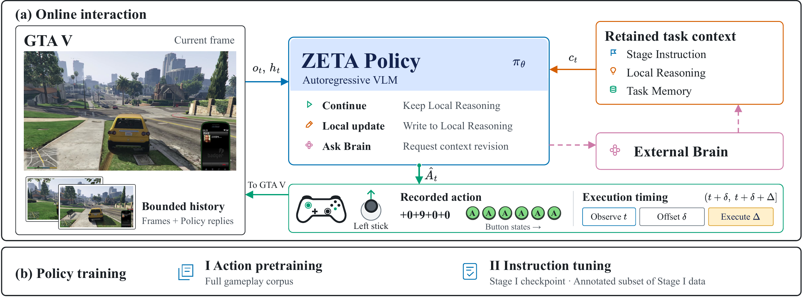
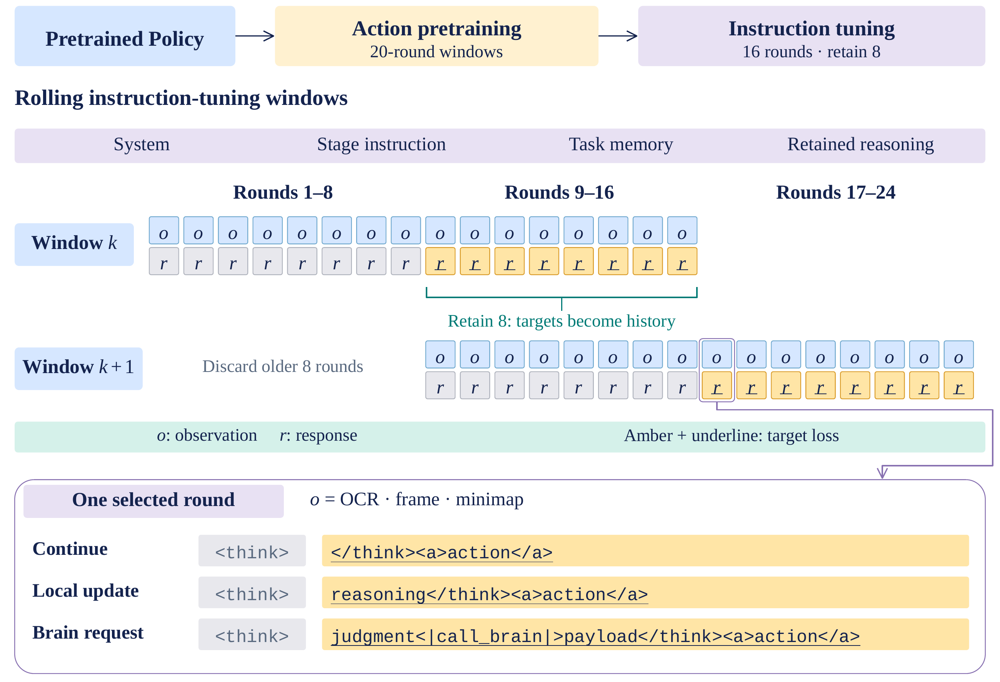
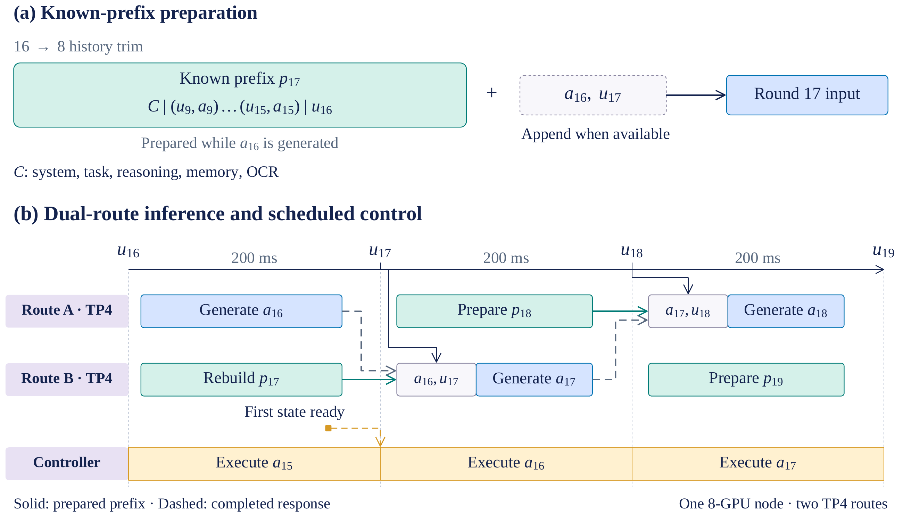

<div align="center">

<h1> ZETA</h1>

### Towards Real-time AGI in the Frontier AAA Game with Zeroth Embodied Task Agent

由 **MOSS-ZETA-preview** 驱动的实时游戏智能体，在 GTA V 中结合视觉控制、自适应思考与持续任务记忆。

[English](README.md) · [项目主页](https://openmoss.ai/MOSS-ZETA/) · [方法](#方法) · [开始使用](#开始使用) · [推理 Infra](infra/README.zh-CN.md)

</div>

https://github.com/user-attachments/assets/0864f57e-090a-4959-9087-6caf0f3a7cd0

## ZETA 是什么？

开放世界游戏既需要快速控制，也需要记住持续数分钟的目标。驾驶、战斗、飞行和步行交互中，同一手柄按键还可能具有不同含义。ZETA 将负责实时视觉控制的 **Policy** 与维护任务上下文的外部 **Brain** 连接起来。名称中的“Zeroth”指向进入物理世界、迈出第一步之前的阶段。

- **根据画面行动**：Policy 结合全屏画面、小地图、可用 OCR 和近期交互历史，生成短时手柄动作。
- **按需思考**：同一响应决定沿用当前计划、调整局部判断，或请求 Brain 重新审视阶段目标。
- **跨越视觉窗口记忆**：阶段指令、任务记忆和局部思考将当前控制与长程目标关联起来。
- **持续推理与执行**：双 TP4 路由交替准备上下文和生成动作，共享 200ms 调度器组织实际执行。

## 视频 Demo

驾驶、追逐、战斗与水中动作，配有动态手柄显示。[项目主页](https://openmoss.ai/MOSS-ZETA/?lang=zh#demos)提供大尺寸播放器和分类筛选。

<table>
  <tr>
    <td width="50%" align="center">
      <strong>成功甩掉警察</strong><br>
      <video src="https://github.com/user-attachments/assets/f2798157-b890-4bb3-83b1-f4632e289fa9" controls width="100%" aria-label="成功甩掉警察"></video><br>
      70秒
    </td>
    <td width="50%" align="center">
      <strong>远距离狙击目标</strong><br>
      <video src="https://github.com/user-attachments/assets/43200feb-8689-4206-8d27-5687e2e7b44f" controls width="100%" aria-label="远距离狙击目标"></video><br>
      10秒
    </td>
  </tr>
  <tr>
    <td width="50%" align="center">
      <strong>直升机侧舱空战</strong><br>
      <video src="https://github.com/user-attachments/assets/48a00ad3-b160-4ceb-8357-f1ed4418b3f3" controls width="100%" aria-label="直升机侧舱空战"></video><br>
      31秒
    </td>
    <td width="50%" align="center">
      <strong>越野摩托追赶飞机</strong><br>
      <video src="https://github.com/user-attachments/assets/cd3a5a2c-893f-4834-b581-adef0e7f510b" controls width="100%" aria-label="越野摩托追赶飞机"></video><br>
      37秒
    </td>
  </tr>
  <tr>
    <td width="50%" align="center">
      <strong>四星追捕下穿越隧道</strong><br>
      <video src="https://github.com/user-attachments/assets/ff8b13f6-d3a4-4d8b-a434-e390a333dc6e" controls width="100%" aria-label="四星追捕下穿越隧道"></video><br>
      36秒
    </td>
    <td width="50%" align="center">
      <strong>从码头跃入海中</strong><br>
      <video src="https://github.com/user-attachments/assets/7db11e90-2e5f-440b-b09d-882d9d254003" controls width="100%" aria-label="从码头跃入海中"></video><br>
      30秒
    </td>
  </tr>
  <tr>
    <td width="50%" align="center">
      <strong>翻越围栏追赶目标</strong><br>
      <video src="https://github.com/user-attachments/assets/72079c68-e439-4722-adab-de65f0f54232" controls width="100%" aria-label="翻越围栏追赶目标"></video><br>
      10秒
    </td>
    <td width="50%" align="center">
      <strong>拖塌山坡建筑</strong><br>
      <video src="https://github.com/user-attachments/assets/37b7a4ad-15a1-4db9-bd00-8bcca8aeb6ce" controls width="100%" aria-label="拖塌山坡建筑"></video><br>
      13秒
    </td>
  </tr>
</table>

## 方法

### 实时控制与任务更新

**System 1 — Policy** 负责当前画面的即时控制，**System 2 — Brain** 根据累计证据审视任务状态。它们通过当前的**阶段指令、任务记忆和局部思考**协同。



| Policy 决策 | 更新内容 | 执行方式 |
| --- | --- | --- |
| 继续执行 | 保留当前判断与任务上下文 | 生成下一段动作 |
| 局部更新 | Policy 给出新判断，Brain 在当前阶段下更新记忆 | 更新准备可与控制并行 |
| 阶段审视 | Brain 重新审视指令、记忆和局部思考 | 确认暂停，提交状态，再恢复执行 |

周期记忆刷新覆盖长时间没有成功更新的情况。启用备用服务时，更新后的上下文要等备用服务准备完成后才会生效，避免尚未完成的更新改变正在运行的 Policy 会话。

### 两阶段 Policy 训练

Policy 从 **Qwen3.5-9B** 初始化。两个阶段训练同一个自回归模型生成手柄动作，第二阶段进一步学习根据任务进行思考和决定何时更新上下文。

| 阶段 | 训练数据 | 学习目标 |
| --- | --- | --- |
| 动作预训练 | 约 4,000 小时人类 GTA V 游戏记录，自由游玩与任务驱动各约一半 | 视觉控制及不同场景中的手柄操作 |
| 指令微调 | 从同一语料中选取约 1,200 小时，补充指令、记忆、思考和更新决策标注 | 将当前动作与任务进度连接起来，并学习按需更新 |



动作预训练使用 20 轮窗口；指令微调最多使用 16 轮，窗口前移时保留最近 8 轮。新选中的响应参与监督，保留历史与已有任务状态作为输入。重复动作损失衰减降低连续相同控制在训练中的权重。

### 面向持续交互的推理

一台 8×H200 节点运行两路独立 TP4：一路生成当前响应，另一路准备下一轮已知前缀。历史从 16 轮裁剪到 8 轮后，先精确重建保留上下文，再继续复用。流式输出让完整的控制状态在整条响应结束前就能送入执行器。



共享调度器为动作分配绝对的 200ms 控制窗口：提前到达的动作等待起点，迟到动作保持原定终点，过期动作丢弃。可选的第二组服务用于任务上下文交接，与单组服务内部的两条推理路由是不同层次。

## 开始使用

本仓库发布 **Harness、推理 Infra 和共享调度器**；模型权重及 GPU 编译扩展需要单独准备。实际运行需要兼容的 ZETA Policy 服务、独立 Brain API，以及运行 GTA V 的 Windows 主机。

### 准备服务

自建 Policy 请按 [Infra 部署说明](infra/docs/deployment.zh-CN.md)准备匹配的运行时、启动两个 GPU worker，再通过 gateway 接入游戏主机。Brain 端点独立配置；Windows 主机需要能访问 gateway 和 Brain。

### 安装 Windows Harness

先安装 **Node.js 22+、Python 3.11 和 ViGEmBus**，再在 PowerShell 中执行：

```powershell
git clone https://github.com/OpenMOSS/MOSS-ZETA.git
cd MOSS-ZETA
npm ci
py -3.11 -m pip install vgamepad
py -3.11 -m pip install -r harness/requirements-ocr.txt
```

在另一个终端中，从仓库根目录启动 OCR 并保持运行：

```powershell
py -3.11 harness/scripts/ocr_service.py --device cpu --warmup
```

### 配置并运行任务

回到第一个终端，填写自己的服务地址和模型名称：

```powershell
$env:OPENAI_BASE_URL = Read-Host "Policy gateway 地址，包含 /v1"
$env:OPENAI_MODEL = Read-Host "Policy 模型名称"
$env:AGI_GTA_BRAIN_BASE_URL = Read-Host "Brain API 地址"
$env:AGI_GTA_BRAIN_MODEL = Read-Host "Brain 模型名称"
$env:AGI_GTA_POLICY_OCR_URL = Read-Host "OCR 服务地址，包含 /ocr"
npm start -- --task "按照当前画面中的任务目标继续行动。"
```

服务需要鉴权时，在同一终端设置 `OPENAI_API_KEY` 和 `AGI_GTA_BRAIN_API_KEY`。**Harness 不预置任何服务 URL 或 API key。** 私有配置使用环境变量或被 Git 忽略的 `*.local.json`，详见 [Harness 配置](harness/README.zh-CN.md#参考配置)。

默认使用 200ms 流式执行、16/8 历史；有效游戏时间累计 10 秒未成功更新记忆时触发兜底刷新。运行不限响应次数，墙钟上限 40 分钟。自动阶段指令刷新默认关闭，Policy 主动调用 Brain 的路径保留。Ctrl+C 停止运行并释放手柄输入，更多参数见 [Harness 说明](harness/README.zh-CN.md)。

## 仓库结构

| 目录 | 内容 |
| --- | --- |
| [harness/](harness/README.zh-CN.md) | Windows 截图与 OCR、Policy–Brain 协同、任务状态和暂停／恢复 |
| [infra/](infra/README.zh-CN.md) | 模型服务、双路 TP4、前缀准备和部署工具 |
| [cadence/](cadence/README.zh-CN.md) | 共享动作解析器、200ms 时钟、流式执行器和原生调度器 |
| [website/](website/) | 双语项目主页、论文图片和视频 |

Harness 直接引用共享调度实现，各组件在同一仓库统一版本。

<details>
<summary>开发检查</summary>

```bash
npm run check
npm test
python infra/tools/cpu_smoke.py
python cadence/scripts/stream-cadence-test.py
python cadence/scripts/stream-handoff-test.py
python cadence/scripts/stream-watchdog-notification-test.py
npm run verify
```

这些检查覆盖 JavaScript 导入、配置、协议、调度和源码完整性。

</details>
